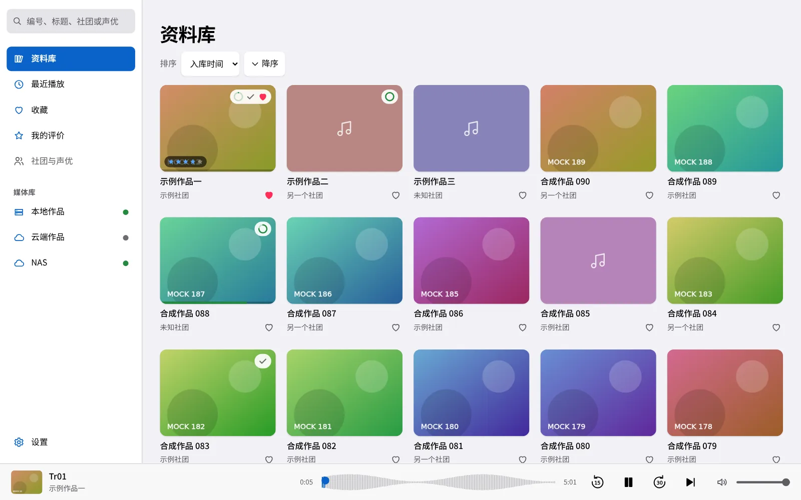
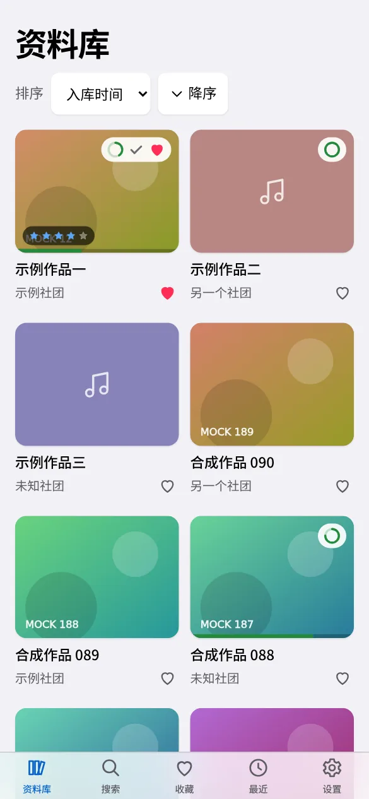
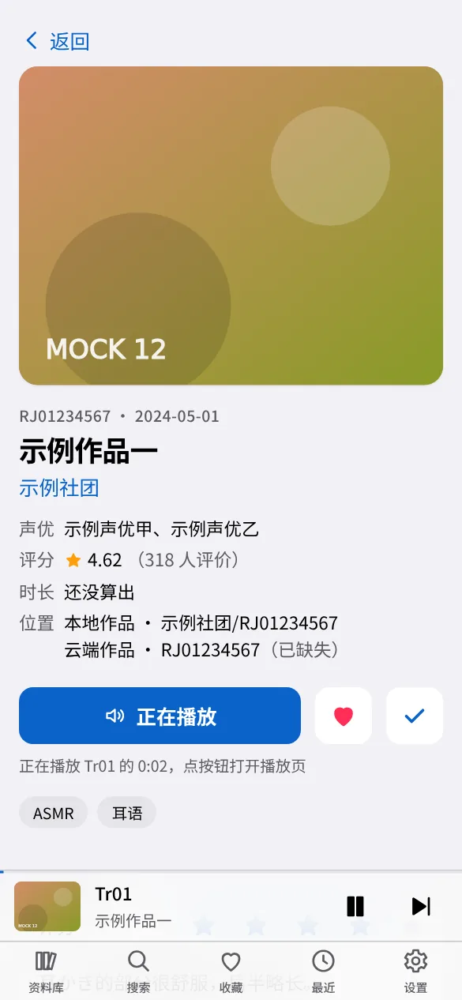
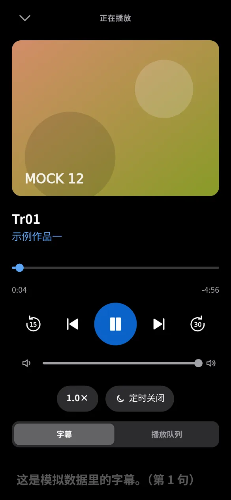
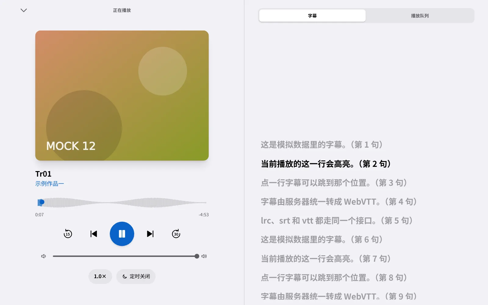
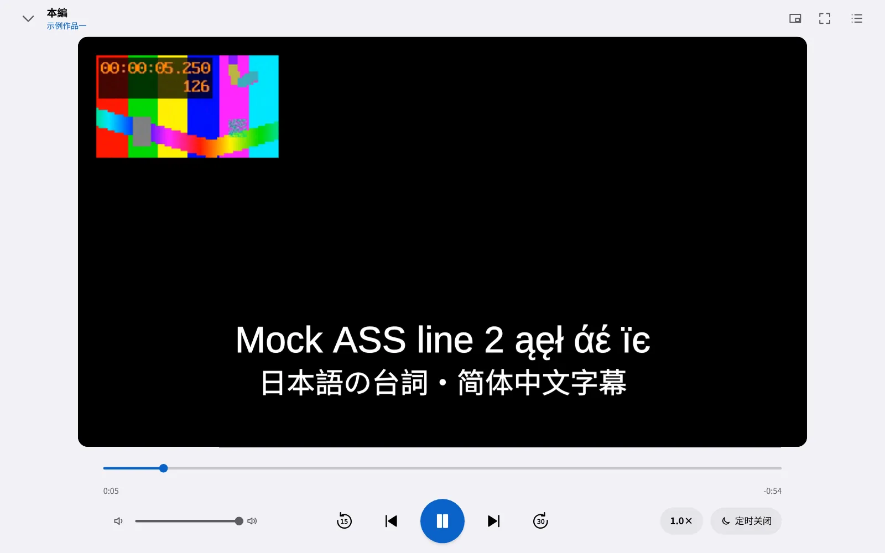
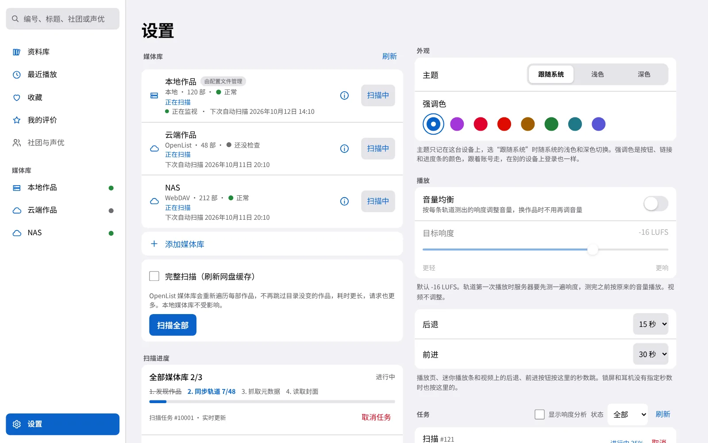

# kikoeru-neo

A self-hosted player for audio dramas and audiobooks, with metadata from DLsite. Browse and play from phone or desktop browsers, or use the desktop app. This is an independent rewrite that reads the old kikoeru-express data format.

The interface is currently in Simplified Chinese. The screenshots use synthetic media.



<table>
  <tr>
    <td></td>
    <td></td>
    <td></td>
  </tr>
</table>

<details>
<summary>More screenshots</summary>





</details>

## Features

- Browse covers, search by circle, voice actor or tag, and keep favorites and reviews.
- Resume playback across devices with server-saved progress. Background playback and media controls depend on the browser and operating system.
- Read local folders, OpenList and WebDAV libraries, with scheduled scans and optional local file watching.
- Fetch metadata and covers from DLsite while preserving manual edits during normal refreshes.
- Play audio with transcoding when needed, and video with HLS fallback and ASS subtitles. Audio also supports waveforms and loudness normalization.
- Use a browser, install a PWA in a supported secure context, or connect through the desktop app.

## Quick start

With Docker Engine 25 or newer on `x86_64` Linux, create an administrator and start the server. Replace `/srv/media/works` with a folder of your media:

```sh
mkdir -p neo-trial && cd neo-trial
printf '# Add libraries in Settings after signing in.\n' > config.toml
chmod 0644 config.toml
image=ghcr.io/qwerchin/kikoeru-neo:0.1.0
docker run --rm -it -e KIKOERU_CONFIG=/config/config.toml \
  -v neo-trial-data:/data -v "$PWD/config.toml:/config/config.toml:ro" \
  "$image" user create --admin admin
docker run -d --name neo-trial -p 127.0.0.1:8888:8888 \
  -v neo-trial-data:/data -v "$PWD/config.toml:/config/config.toml:ro" \
  -v /srv/media/works:/media/works:ro \
  "$image"
```

Enter a password of at least 8 characters when prompted. Open `http://127.0.0.1:8888`, sign in, and add a local library in Settings with the path `/media/works`. Work folder names must contain `RJ`, `BJ` or `VJ` followed by 6 to 8 digits, such as the synthetic `RJ01234567 Example work`. Save the library, start its scan, then open a work and play a track.

The image includes ffmpeg and ffprobe. See the [quick-start guide](docs/en/quickstart.md) for stopping and removing the trial, and the [security guide](docs/en/security.md) before exposing the service to another device. Core playback supports HTTP; Service Workers and PWA installation require a supported secure context.

## Installation

- [Docker Compose](docs/en/install-docker.md) with the published image, a Dockerfile build or a Nix build.
- A [standalone binary](docs/en/install-binary.md) for any `x86_64` Linux distribution. It needs ffmpeg and ffprobe from your distribution.
- A [NixOS](docs/en/install-nixos.md) system service.
- The [desktop app](docs/en/desktop.md) for a separate window or a library on your own computer.

## Guides

- [User guide](docs/en/index.md).
- [Configuration](docs/en/configuration.md), [libraries and scans](docs/en/libraries.md), and [accounts](docs/en/accounts.md).
- [Migration from kikoeru-express](docs/en/migration.md), [backup and restore](docs/en/backup-restore.md), and [upgrades](docs/en/upgrade.md).
- [Troubleshooting](docs/en/troubleshooting.md).

## Contributing

Read [CONTRIBUTING.md](CONTRIBUTING.md) for development, tests and pull requests. A Dev Container with every tool is included, so Docker is enough to start. The implementation design book is maintained in Chinese only; it is not required for installing or using the player.

## License

GPL-3.0-or-later. See [LICENSE](LICENSE).
